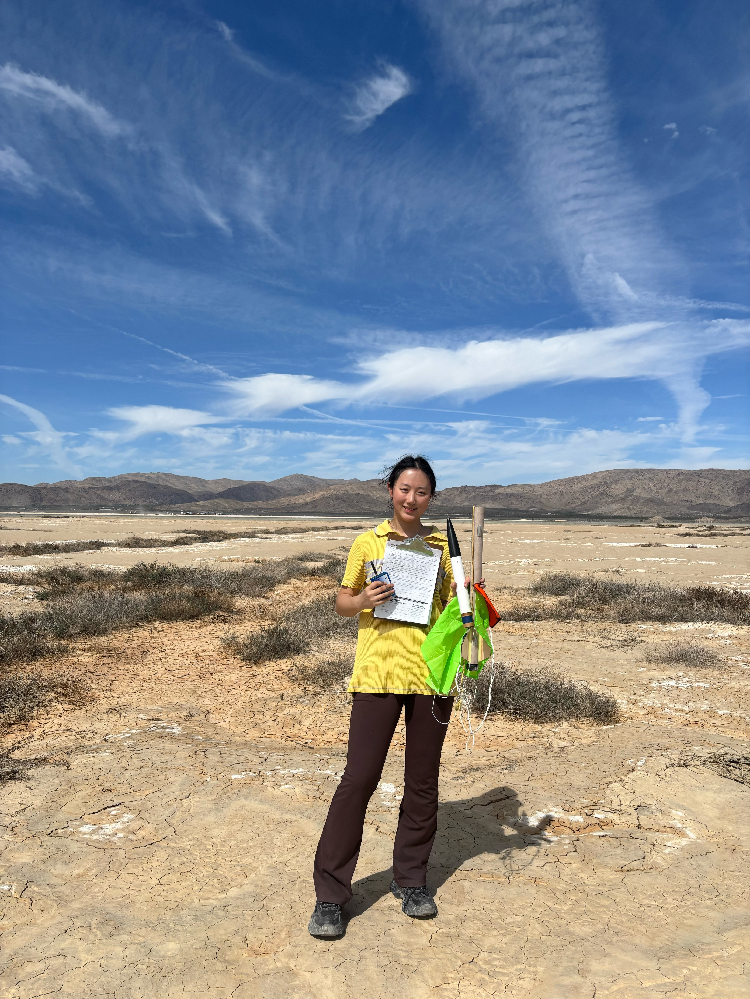

::: {.hero}
::: {.hero-text}
[Electrical Engineering · Harvey Mudd College]{.eyebrow}

<h1 class="hero-title">Hi, I'm Angela.</h1>

I build digital hardware and the embedded systems that go with it. Most days that means writing SystemVerilog for FPGAs, C for microcontrollers, or laying out the PCBs that hold it all together.

::: {.hero-actions}
[View projects](projects.qmd){.btn .btn-primary .btn-lg}
[GitHub](https://github.com/AngelaZzzzz){.btn .btn-outline-primary .btn-lg}
[LinkedIn](https://www.linkedin.com/in/angela-zheng-240a0b218){.btn .btn-outline-primary .btn-lg}
:::
:::

::: {.hero-photo}
{fig-alt="Portrait of Angela Zheng"}
:::
:::

::: {.section-block}
<h2 class="section-title">About</h2>

::: {.about-grid}
::: {.about-text}
I'm a junior Electrical Engineering major at [Harvey Mudd College](https://hmc.edu). I'm
happiest working where hardware meets software: writing RTL, bringing up boards, and chasing
down bugs on an oscilloscope. I've built a multicycle RISC-V processor, a sensor-laden ocean
robot, and two high-power rockets (I'm L2 certified). Outside of the lab, I spend my time with my dog Charlie, my hens
Becky and Becca, and my 42 (still unnamed) quails.
:::

::: {.skills}
[Digital Design]{.skill-heading}
[SystemVerilog]{.chip} [RISC-V]{.chip} [FPGA (iCE40)]{.chip} [FSMs]{.chip} [QuestaSim]{.chip} [Lattice Radiant]{.chip}

[Embedded Systems]{.skill-heading}
[C]{.chip} [STM32]{.chip} [Interrupts]{.chip} [Timers]{.chip} [SPI]{.chip}

[Hardware]{.skill-heading}
[PCB Design]{.chip} [Analog Signal Conditioning]{.chip} [Sensors & Calibration]{.chip} [Oscilloscope Debugging]{.chip}

[Tools & Fabrication]{.skill-heading}
[Yosys / nextpnr]{.chip} [MATLAB]{.chip} [SolidWorks]{.chip} [Laser Cutting]{.chip} [High-Power Rocketry]{.chip}
:::
:::
:::

::: {.section-block}
::: {.section-head}
<h2 class="section-title">Featured Projects</h2>
[All projects →](projects.qmd){.section-link}
:::

::: {#featured-projects}
:::
:::

::: {.section-block}
::: {.section-head}
<h2 class="section-title">Recent E155 Labs</h2>
[All labs →](labs.qmd){.section-link}
:::

::: {#recent-labs}
:::
:::
