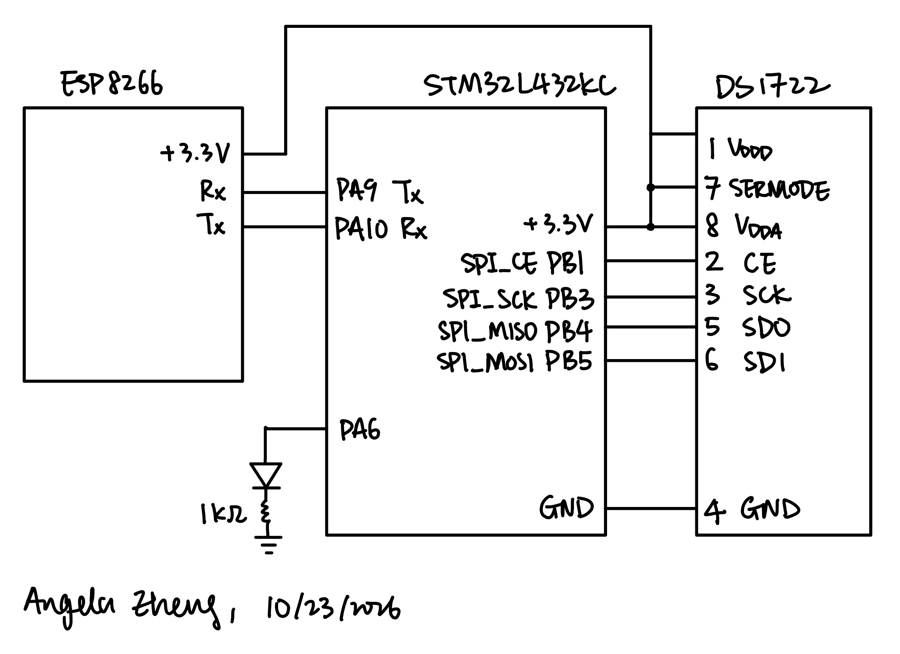
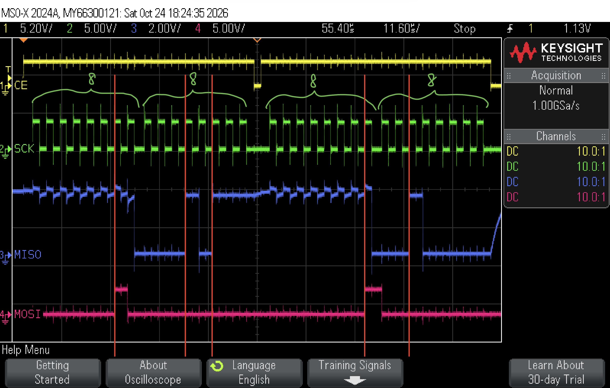
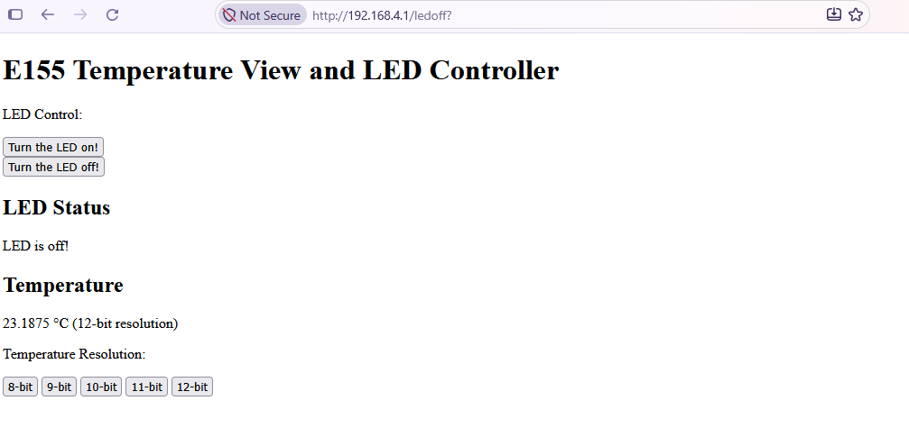

## Introduction

The goal of this lab was to build a simple Internet of Things (IoT) device. An ESP8266 WiFi
module hosts a web page that lets a user turn an LED on and off (on `PA6`) and view the current room
temperature. The STM32L432KC MCU receives data from the temperature sensor via SPI, 
generates the HTML page, and sends data to the ESP8266 WiFI module via UART, which forwards it
to the browser.

Beyond the LED control and temperature display, the web page also lets the user change
the sensor's resolution from 8 to 12 bits. The temperature is displayed with as many decimal
places as the selected resolution provides, 0 for 8 bits, 1 for 9 bits, 2 for 10 bits, 3 for 11 bits,
and 4 for 12 bits.

## Design and Testing Methodology

The GPIO, RCC, FLASH, TIM, and USART libraries and the ESP8266 web server code come from the
[Lab 6 starter code](https://github.com/HMC-E155/hmc-e155/tree/main/lab/lab06). I wrote the SPI driver (`STM32L432KC_SPI.c/h`), the DS1722 driver
(`DS1722.c/h`), and the request handling and web page generation in `main.c`.

### ESP8266–MCU interface

The ESP8266 is connected to `USART1` on the MCU, with the MCU TX (`PA9`) going to
ESP RX and MCU RX (`PA10`) going to ESP TX. Each time a browser loads the page, the ESP8266 sends
the most recent request as `/REQ:<tag>\n`, and the main loop 
1. Reads characters from the UART until it sees `\n`.
2. Checks the request for a resolution tag (`res8` to `res12`) and reconfigures the DS1722 if
   one is present.
3. Reads the temperature over SPI.
4. Checks the request for `ledon` / `ledoff` and drives `PA6`.
5. Sends the full HTML page, from `<!DOCTYPE html>` to `</html>`, back over the UART.

### SPI driver

The SPI driver initializes `SPI1` in the following way:

`initSPI(br, cpol, cpha)` configures
- **Pins:** `SCK` on `PB3`, `MISO` on `PB4` and `MOSI` on `PB5`, all set to alternate
  function 5. The chip enable `CE` is on `PB1`.
- **`CR1`:** master mode, software slave management (`SSM`, `SSI`), MSB first, and sets the baud
  rate, polarity, and phase according to the arguments.
- **`CR2`:** 8-bit data size (`DS = 0b0111`) with `FRXTH` set, so `RXNE` flags after a single byte.

In `main.c`, The DS1722 is initialized with `initSPI(0b111, 0, 1)`:

- `BR = 0b111` divides the 80 MHz clock by 256, giving a **312.5 kHz SCK**, which is under the
  DS1722's 5 MHz maximum.
- `CPOL = 0, CPHA = 1` configures data to change on the rising edge of SCK and sampled on the falling edge.

`spiSendReceive()` waits for `TXE`, writes one byte to `DR`, waits for `RXNE`, and then returns the
received byte. `DR` is accessed through an 8-bit pointer so that each write sends one byte only.

### DS1722 driver

Every DS1722 transaction is an address byte followed by a data byte inside one chip-enable window.
`readTempRaw()` combines the two bytes into a signed 16-bit value. The temperature in °C is then `raw / 256`.

### Testing

1. **SPI without the temperature sensor.** Before wiring the DS1722, I probed `CE`, `SCK`, `MOSI` and `MISO`
   with an oscop, using its logic analyzer function. I checked that the configuration write and the temperature reads
   produced the right addresses, data, clock polarity and phase, and chip-enable framing.
2. **SPI with the sensor.** With the DS1722 connected, I probed the SPI channels again and checked that the MOSI and MISO bytes are as expected.
3. **Web page.** I connected to the ESP8266's access point, loaded `http://192.168.4.1/`, and
   checked that the temperature shown is reasonable, the LED buttons toggled the LED and its status text, and that each resolution
   button changed the number of decimal places shown.

## Technical Documentation

The source code for the project can be found in the associated [GitHub repository](https://github.com/AngelaZzzzz/hmc-e155-MicroPs/tree/main/labs/lab6/).

### Schematic

{width=90% fig-align="center"}

The DS1722's `VDDD`, `VDDA` and `SERMODE` pins are tied to the MCU's 3.3 V supply. Pulling
`SERMODE` high selects SPI mode on the temperature sensor. `CE`, `SCK`, `SDO` and `SDI` connect to `PB1`, `PB3`, `PB4`
(MISO) and `PB5` (MOSI). The ESP8266 is powered using 3.3 V, with its RX and TX
connected to the MCU's TX and RX. The LED is driven from `PA6` through a 1 kΩ current-limiting resistor.

### SPI logic analyzer capture

{width=95% fig-align="center"}

Figure 2 shows one full temperature read SPI transaction. Channel 1 (yellow) is `CE`, 2 (green) is `SCK`, 3 (blue) is `MISO`, and 4 (pink) is `MOSI`. We can see that the first time CE is high, MOSI sends address `0x02` in the first 8 clock cycles and the DS1722 replies on MISO with the temperature MSB `0x17` (23 °C) in the second clock cycle. In the second time CE is high, MOSI sends `0x01` in the first 8 clock cycles and the DS1722 replies with the LSB `0x20` (0.125 °C) in the second 8 clock cycles. Combining the MSB and LSB, we get a temperature reading of 23.125 °C.

## Results and Discussion

{width=90% fig-align="center"}

The device works as intended. Loading `http://192.168.4.1/` shows the LED controls, the LED
status, the current temperature, and the resolution buttons. Clicking *Turn the LED on!* or
*Turn the LED off!* changes both the LED and its status text accordingly. The temperature reads about 23 °C,
which is a reasonable room temperature.

Moreover, the logic analyzer capture confirms the SPI timing. We verified that `CE` stays high for the whole two-byte
transaction, data changes on the rising edge of `SCK`, and the sensor's MISO bytes match the temperature on the web page.

The design meets all of the proficiency and execellence requirements.

## Conclusion

The STM32L432KC microcontroller parses web requests from the ESP8266 over UART, controls an LED, reads temperature from the DS1722
over a CMSIS-based SPI driver, and sends back to the ESP8266 with an HTML page with the LED state and the current temperature at a selectable resolution.

I spent a total of 12 hours working on this lab.

## AI Prototype Summary

Model used: **Claude Haiku 5.5**

### AI Chat Transcript

<details>
<summary>User Prompt</summary>

I’m making a web portal to interface with a temperature sensor. Create a HTML page that looks good and is intuitive to show the temperature, control an LED, and change the precision of the readout.

</details>

<details>
<summary>AI Response</summary>

```
<!DOCTYPE html>
<html lang="en">
<head>
<meta charset="UTF-8">
<meta name="viewport" content="width=device-width, initial-scale=1.0">
<title>Sensor Portal</title>
<style>
  :root {
    --bg: #0f1420;
    --panel: #171f30;
    --panel-border: #24304a;
    --text: #e8edf7;
    --muted: #8a96b0;
    --accent: #4f8cff;
    --accent-2: #7c5cff;
    --good: #34d399;
    --bad: #f87171;
    --led-glow: #ffd166;
    --radius: 16px;
    --shadow: 0 10px 30px rgba(0, 0, 0, 0.35);
  }

  @media (prefers-color-scheme: light) {
    :root:not([data-theme="dark"]) {
      --bg: #eef2f8;
      --panel: #ffffff;
      --panel-border: #dbe2ee;
      --text: #1b2333;
      --muted: #66728a;
      --shadow: 0 10px 25px rgba(30, 50, 90, 0.08);
    }
  }
  :root[data-theme="light"] {
    --bg: #eef2f8;
    --panel: #ffffff;
    --panel-border: #dbe2ee;
    --text: #1b2333;
    --muted: #66728a;
    --shadow: 0 10px 25px rgba(30, 50, 90, 0.08);
  }

  * { box-sizing: border-box; }

  html, body {
    margin: 0;
    padding: 0;
    min-height: 100%;
  }

  body {
    font-family: -apple-system, BlinkMacSystemFont, "Segoe UI", Roboto, "Helvetica Neue", Arial, sans-serif;
    background:
      radial-gradient(1200px 600px at 10% -10%, rgba(79, 140, 255, 0.18), transparent 60%),
      radial-gradient(900px 500px at 110% 10%, rgba(124, 92, 255, 0.15), transparent 60%),
      var(--bg);
    color: var(--text);
    padding: 24px 16px 48px;
  }

  .wrap {
    max-width: 980px;
    margin: 0 auto;
  }

  header {
    display: flex;
    align-items: center;
    justify-content: space-between;
    flex-wrap: wrap;
    gap: 12px;
    margin-bottom: 24px;
  }

  header h1 {
    font-size: 1.5rem;
    margin: 0;
    font-weight: 700;
    letter-spacing: -0.01em;
  }

  header p {
    margin: 4px 0 0;
    color: var(--muted);
    font-size: 0.9rem;
  }

  .status {
    display: inline-flex;
    align-items: center;
    gap: 8px;
    padding: 8px 14px;
    border-radius: 999px;
    background: var(--panel);
    border: 1px solid var(--panel-border);
    font-size: 0.85rem;
    color: var(--muted);
    white-space: nowrap;
  }

  .dot {
    width: 9px;
    height: 9px;
    border-radius: 50%;
    background: var(--muted);
    box-shadow: 0 0 0 0 currentColor;
  }
  .status.online .dot { background: var(--good); color: var(--good); animation: pulse 2s infinite; }
  .status.offline .dot { background: var(--bad); }
  .status.sim .dot { background: var(--accent); color: var(--accent); animation: pulse 2s infinite; }

  @keyframes pulse {
    0% { box-shadow: 0 0 0 0 rgba(79, 140, 255, 0.5); }
    70% { box-shadow: 0 0 0 8px rgba(79, 140, 255, 0); }
    100% { box-shadow: 0 0 0 0 rgba(79, 140, 255, 0); }
  }

  .grid {
    display: grid;
    grid-template-columns: 1.6fr 1fr;
    gap: 20px;
  }

  @media (max-width: 760px) {
    .grid { grid-template-columns: 1fr; }
  }

  .card {
    background: var(--panel);
    border: 1px solid var(--panel-border);
    border-radius: var(--radius);
    padding: 22px;
    box-shadow: var(--shadow);
  }

  .card h2 {
    margin: 0 0 16px;
    font-size: 0.8rem;
    text-transform: uppercase;
    letter-spacing: 0.08em;
    color: var(--muted);
    font-weight: 600;
    display: flex;
    justify-content: space-between;
    align-items: center;
    gap: 8px;
  }

  /* Temperature card */
  .reading {
    display: flex;
    align-items: baseline;
    gap: 6px;
    margin: 6px 0 4px;
  }

  .temp-value {
    font-size: clamp(3.5rem, 9vw, 5.5rem);
    font-weight: 800;
    font-variant-numeric: tabular-nums;
    letter-spacing: -0.03em;
    line-height: 1;
    transition: color 0.4s ease;
  }

  .temp-unit {
    font-size: 1.75rem;
    font-weight: 600;
    color: var(--muted);
  }

  .temp-meta {
    display: flex;
    gap: 16px;
    flex-wrap: wrap;
    color: var(--muted);
    font-size: 0.9rem;
    margin-bottom: 16px;
  }

  .trend {
    font-weight: 600;
  }
  .trend.up { color: var(--bad); }
  .trend.down { color: var(--accent); }
  .trend.flat { color: var(--muted); }

  .segmented {
    display: inline-flex;
    background: var(--bg);
    border: 1px solid var(--panel-border);
    border-radius: 10px;
    padding: 3px;
    gap: 2px;
  }

  .segmented button {
    font: inherit;
    font-size: 0.85rem;
    font-weight: 600;
    color: var(--muted);
    background: transparent;
    border: none;
    padding: 7px 12px;
    border-radius: 7px;
    cursor: pointer;
    transition: all 0.2s ease;
    min-width: 42px;
  }

  .segmented button:hover { color: var(--text); }

  .segmented button[aria-pressed="true"] {
    background: linear-gradient(135deg, var(--accent), var(--accent-2));
    color: #fff;
    box-shadow: 0 4px 12px rgba(79, 140, 255, 0.35);
  }

  .chart-wrap {
    margin-top: 18px;
    height: 110px;
    position: relative;
  }

  .chart-wrap svg {
    width: 100%;
    height: 100%;
    display: block;
  }

  .chart-empty {
    position: absolute;
    inset: 0;
    display: flex;
    align-items: center;
    justify-content: center;
    color: var(--muted);
    font-size: 0.85rem;
  }

  .stats {
    display: grid;
    grid-template-columns: repeat(3, 1fr);
    gap: 10px;
    margin-top: 16px;
  }

  .stat {
    background: var(--bg);
    border: 1px solid var(--panel-border);
    border-radius: 12px;
    padding: 10px 12px;
  }

  .stat .label {
    font-size: 0.72rem;
    text-transform: uppercase;
    letter-spacing: 0.06em;
    color: var(--muted);
  }

  .stat .val {
    font-size: 1.05rem;
    font-weight: 700;
    font-variant-numeric: tabular-nums;
    margin-top: 2px;
  }

  /* LED card */
  .led-stage {
    display: flex;
    flex-direction: column;
    align-items: center;
    gap: 18px;
    padding: 8px 0 4px;
  }

  .led-bulb {
    width: 110px;
    height: 110px;
    border-radius: 50%;
    background: radial-gradient(circle at 35% 30%, #3a4358, #1a2030 70%);
    border: 2px solid var(--panel-border);
    transition: all 0.35s ease;
    position: relative;
  }

  .led-bulb.on {
    background: radial-gradient(circle at 35% 30%, #fffbe6, var(--led-glow) 55%, #e0a100);
    border-color: #ffe08a;
    box-shadow:
      0 0 25px 6px rgba(255, 209, 102, 0.55),
      0 0 70px 20px rgba(255, 209, 102, 0.25);
  }

  .led-state {
    font-weight: 600;
    font-size: 0.95rem;
    color: var(--muted);
  }
  .led-state.on { color: var(--led-glow); }

  .switch {
    position: relative;
    width: 64px;
    height: 34px;
    flex-shrink: 0;
  }

  .switch input {
    opacity: 0;
    width: 0;
    height: 0;
    position: absolute;
  }

  .switch .slider {
    position: absolute;
    inset: 0;
    background: var(--bg);
    border: 1px solid var(--panel-border);
    border-radius: 999px;
    cursor: pointer;
    transition: 0.25s;
  }

  .switch .slider::before {
    content: "";
    position: absolute;
    height: 26px;
    width: 26px;
    left: 3px;
    top: 3px;
    background: #fff;
    border-radius: 50%;
    transition: 0.25s;
    box-shadow: 0 2px 6px rgba(0, 0, 0, 0.3);
  }

  .switch input:checked + .slider {
    background: linear-gradient(135deg, #ffb703, #ffd166);
    border-color: transparent;
  }

  .switch input:checked + .slider::before {
    transform: translateX(30px);
  }

  .switch input:focus-visible + .slider {
    outline: 2px solid var(--accent);
    outline-offset: 3px;
  }

  .switch input:disabled + .slider {
    opacity: 0.5;
    cursor: not-allowed;
  }

  .led-row {
    display: flex;
    align-items: center;
    justify-content: space-between;
    width: 100%;
    padding: 12px 14px;
    background: var(--bg);
    border: 1px solid var(--panel-border);
    border-radius: 12px;
  }

  .led-row span {
    font-weight: 600;
  }

  .hint {
    color: var(--muted);
    font-size: 0.8rem;
    margin-top: 14px;
    line-height: 1.5;
  }

  /* Settings */
  .settings {
    margin-top: 20px;
  }

  .field {
    display: flex;
    flex-direction: column;
    gap: 6px;
    margin-bottom: 12px;
  }

  .field label {
    font-size: 0.8rem;
    color: var(--muted);
    font-weight: 600;
  }

  .field input {
    font: inherit;
    font-size: 0.95rem;
    padding: 10px 12px;
    border-radius: 10px;
    border: 1px solid var(--panel-border);
    background: var(--bg);
    color: var(--text);
  }

  .field input:focus {
    outline: 2px solid var(--accent);
    outline-offset: 1px;
  }

  .row-buttons {
    display: flex;
    gap: 10px;
    flex-wrap: wrap;
  }

  .btn {
    font: inherit;
    font-size: 0.9rem;
    font-weight: 600;
    padding: 10px 16px;
    border-radius: 10px;
    border: 1px solid var(--panel-border);
    background: var(--bg);
    color: var(--text);
    cursor: pointer;
    transition: transform 0.1s ease, background 0.2s ease;
  }

  .btn:hover { background: var(--panel); }
  .btn:active { transform: scale(0.97); }

  .btn.primary {
    background: linear-gradient(135deg, var(--accent), var(--accent-2));
    color: #fff;
    border: none;
  }

  .toast {
    position: fixed;
    bottom: 20px;
    left: 50%;
    transform: translateX(-50%) translateY(20px);
    background: var(--panel);
    border: 1px solid var(--panel-border);
    box-shadow: var(--shadow);
    padding: 10px 16px;
    border-radius: 10px;
    font-size: 0.9rem;
    opacity: 0;
    pointer-events: none;
    transition: all 0.3s ease;
  }

  .toast.show {
    opacity: 1;
    transform: translateX(-50%) translateY(0);
  }

  .toast.error { color: var(--bad); }
</style>
</head>
<body>
<div class="wrap">

  <header>
    <div>
      <h1>Sensor Portal</h1>
      <p>Live temperature, LED control, and readout settings</p>
    </div>
    <div id="status" class="status" role="status" aria-live="polite">
      <span class="dot"></span>
      <span id="statusText">Connecting…</span>
    </div>
  </header>

  <div class="grid">

    <!-- Temperature -->
    <section class="card" aria-labelledby="tempHeading">
      <h2 id="tempHeading">
        Temperature
        <div class="segmented" role="group" aria-label="Temperature unit">
          <button data-unit="C" aria-pressed="true">°C</button>
          <button data-unit="F" aria-pressed="false">°F</button>
          <button data-unit="K" aria-pressed="false">K</button>
        </div>
      </h2>

      <div class="reading">
        <span id="tempValue" class="temp-value">--.-</span>
        <span id="tempUnit" class="temp-unit">°C</span>
      </div>

      <div class="temp-meta">
        <span id="trend" class="trend flat">● Steady</span>
        <span>Updated <span id="lastUpdated">never</span></span>
      </div>

      <div class="chart-wrap">
        <svg id="chart" viewBox="0 0 600 110" preserveAspectRatio="none" aria-label="Temperature history">
          <defs>
            <linearGradient id="fill" x1="0" x2="0" y1="0" y2="1">
              <stop offset="0%" stop-color="#4f8cff" stop-opacity="0.35"/>
              <stop offset="100%" stop-color="#4f8cff" stop-opacity="0"/>
            </linearGradient>
            <linearGradient id="line" x1="0" x2="1" y1="0" y2="0">
              <stop offset="0%" stop-color="#4f8cff"/>
              <stop offset="100%" stop-color="#7c5cff"/>
            </linearGradient>
          </defs>
          <path id="area" fill="url(#fill)" d=""/>
          <polyline id="trace" fill="none" stroke="url(#line)" stroke-width="2.5" stroke-linejoin="round" stroke-linecap="round" points=""/>
        </svg>
        <div id="chartEmpty" class="chart-empty">Waiting for data…</div>
      </div>

      <div class="stats">
        <div class="stat"><div class="label">Min</div><div class="val" id="statMin">--</div></div>
        <div class="stat"><div class="label">Avg</div><div class="val" id="statAvg">--</div></div>
        <div class="stat"><div class="label">Max</div><div class="val" id="statMax">--</div></div>
      </div>
    </section>

    <div style="display:flex;flex-direction:column;gap:20px;">

      <!-- Precision -->
      <section class="card" aria-labelledby="precHeading">
        <h2 id="precHeading">Precision</h2>
        <div class="segmented" role="group" aria-label="Decimal places" id="precGroup">
          <button data-prec="0" aria-pressed="false">0</button>
          <button data-prec="1" aria-pressed="true">1</button>
          <button data-prec="2" aria-pressed="false">2</button>
          <button data-prec="3" aria-pressed="false">3</button>
        </div>
        <p class="hint">Decimal places shown on the readout. Higher precision shows more sensor noise.</p>
      </section>

      <!-- LED -->
      <section class="card" aria-labelledby="ledHeading">
        <h2 id="ledHeading">LED Control</h2>
        <div class="led-stage">
          <div id="ledBulb" class="led-bulb" aria-hidden="true"></div>
          <div id="ledState" class="led-state">Off</div>
          <div class="led-row">
            <span>Power</span>
            <label class="switch">
              <input type="checkbox" id="ledToggle" aria-label="LED power">
              <span class="slider"></span>
            </label>
          </div>
        </div>
      </section>

    </div>
  </div>

  <!-- Connection settings -->
  <section class="card settings" aria-labelledby="setHeading">
    <h2 id="setHeading">Connection</h2>
    <div class="field">
      <label for="apiBase">Device API base URL (leave blank for same origin)</label>
      <input id="apiBase" type="text" placeholder="http://192.168.1.50" autocomplete="off">
    </div>
    <div class="field">
      <label for="pollMs">Poll interval (ms)</label>
      <input id="pollMs" type="number" min="200" step="100" value="1000">
    </div>
    <div class="row-buttons">
      <button class="btn primary" id="applyBtn">Apply &amp; reconnect</button>
      <button class="btn" id="simBtn">Use simulated sensor</button>
      <button class="btn" id="themeBtn">Toggle theme</button>
    </div>
  </section>

</div>

<div id="toast" class="toast" role="alert"></div>

<script>
/* ==========================================================================
   CONFIGURATION
   Expected device API (adjust the paths/shapes to match your firmware):
     GET  /api/temperature  ->  { "celsius": 23.456 }
     GET  /api/led          ->  { "on": true }
     POST /api/led          <-  { "on": true }   returns { "on": true }
   ========================================================================== */
const CONFIG = {
  apiBase: "",
  pollMs: 1000,
  endpoints: {
    temperature: "/api/temperature",
    led: "/api/led"
  },
  historyLength: 120,
  requestTimeoutMs: 2000
};

/* ---------- State ---------- */
const state = {
  unit: "C",
  precision: 1,
  celsius: null,
  history: [],
  ledOn: false,
  online: false,
  simulated: false,
  pollTimer: null,
  simTick: 0,
  simLedOn: false
};

/* ---------- Persistence (per-browser preferences) ---------- */
function loadPrefs() {
  try {
    const p = JSON.parse(localStorage.getItem("sensorPortalPrefs") || "{}");
    if (p.unit) state.unit = p.unit;
    if (Number.isInteger(p.precision)) state.precision = p.precision;
    if (p.apiBase !== undefined) CONFIG.apiBase = p.apiBase;
    if (p.pollMs) CONFIG.pollMs = p.pollMs;
    if (p.theme) document.documentElement.dataset.theme = p.theme;
    if (p.simulated !== undefined) state.simulated = p.simulated;
  } catch (_) { /* storage unavailable, use defaults */ }
}

function savePrefs() {
  try {
    localStorage.setItem("sensorPortalPrefs", JSON.stringify({
      unit: state.unit,
      precision: state.precision,
      apiBase: CONFIG.apiBase,
      pollMs: CONFIG.pollMs,
      theme: document.documentElement.dataset.theme || "",
      simulated: state.simulated
    }));
  } catch (_) { /* ignore */ }
}

/* ---------- Helpers ---------- */
const $ = (id) => document.getElementById(id);

function toast(msg, isError = false) {
  const t = $("toast");
  t.textContent = msg;
  t.className = "toast show" + (isError ? " error" : "");
  clearTimeout(toast._h);
  toast._h = setTimeout(() => { t.className = "toast"; }, 2400);
}

function convert(c, unit) {
  if (unit === "F") return c * 9 / 5 + 32;
  if (unit === "K") return c + 273.15;
  return c;
}

function unitSymbol(unit) {
  return unit === "F" ? "°F" : unit === "K" ? "K" : "°C";
}

/* Map temperature (°C) to a color from cool blue to warm red */
function tempColor(c) {
  const t = Math.max(0, Math.min(40, c));
  const hue = 215 - (t / 40) * 215; // 215 (blue) -> 0 (red)
  return `hsl(${hue}, 85%, 62%)`;
}

async function fetchWithTimeout(url, options = {}) {
  const controller = new AbortController();
  const timer = setTimeout(() => controller.abort(), CONFIG.requestTimeoutMs);
  try {
    const res = await fetch(url, { ...options, signal: controller.signal });
    if (!res.ok) throw new Error("HTTP " + res.status);
    return await res.json();
  } finally {
    clearTimeout(timer);
  }
}

/* ---------- Device I/O (real hardware, with simulator fallback) ---------- */
const device = {
  url(path) {
    return (CONFIG.apiBase || "").replace(/\/$/, "") + path;
  },

  async readTemperature() {
    if (state.simulated) return simulator.temperature();
    const data = await fetchWithTimeout(this.url(CONFIG.endpoints.temperature));
    if (typeof data.celsius !== "number") throw new Error("Bad temperature payload");
    return data.celsius;
  },

  async readLed() {
    if (state.simulated) return state.simLedOn;
    const data = await fetchWithTimeout(this.url(CONFIG.endpoints.led));
    return !!data.on;
  },

  async writeLed(on) {
    if (state.simulated) {
      state.simLedOn = on;
      return on;
    }
    const data = await fetchWithTimeout(this.url(CONFIG.endpoints.led), {
      method: "POST",
      headers: { "Content-Type": "application/json" },
      body: JSON.stringify({ on })
    });
    return !!data.on;
  }
};

/* Simulated sensor so the UI can be previewed without hardware */
const simulator = {
  temperature() {
    state.simTick += 1;
    const base = 22 + 3 * Math.sin(state.simTick / 25) + 1.2 * Math.sin(state.simTick / 7);
    const noise = (Math.random() - 0.5) * 0.15;
    const ledBoost = state.simLedOn ? 1.5 : 0;
    return base + ledBoost + noise;
  }
};

/* ---------- Status ---------- */
function setStatus(kind, text) {
  const el = $("status");
  el.className = "status " + kind;
  $("statusText").textContent = text;
}

/* ---------- Rendering ---------- */
function renderTemperature() {
  const valEl = $("tempValue");
  if (state.celsius === null) {
    valEl.textContent = "--";
    return;
  }
  const shown = convert(state.celsius, state.unit);
  valEl.textContent = shown.toFixed(state.precision);
  valEl.style.color = tempColor(state.celsius);
  $("tempUnit").textContent = unitSymbol(state.unit);
  renderStats();
  renderChart();
}

function renderTrend() {
  const h = state.history;
  const el = $("trend");
  if (h.length < 5) {
    el.className = "trend flat";
    el.textContent = "● Gathering data";
    return;
  }
  const recent = h.slice(-5);
  const delta = recent[recent.length - 1] - recent[0];
  if (delta > 0.05) {
    el.className = "trend up";
    el.textContent = "▲ Rising";
  } else if (delta < -0.05) {
    el.className = "trend down";
    el.textContent = "▼ Falling";
  } else {
    el.className = "trend flat";
    el.textContent = "● Steady";
  }
}

function renderStats() {
  const h = state.history;
  if (!h.length) return;
  const fmt = (c) => convert(c, state.unit).toFixed(state.precision) + " " + unitSymbol(state.unit);
  const min = Math.min(...h);
  const max = Math.max(...h);
  const avg = h.reduce((a, b) => a + b, 0) / h.length;
  $("statMin").textContent = fmt(min);
  $("statAvg").textContent = fmt(avg);
  $("statMax").textContent = fmt(max);
}

function renderChart() {
  const h = state.history;
  if (h.length < 2) {
    $("chartEmpty").style.display = "flex";
    $("trace").setAttribute("points", "");
    $("area").setAttribute("d", "");
    return;
  }
  $("chartEmpty").style.display = "none";

  const W = 600, H = 110, pad = 8;
  const lo = Math.min(...h) - 0.5;
  const hi = Math.max(...h) + 0.5;
  const span = Math.max(hi - lo, 0.5);
  const step = W / (CONFIG.historyLength - 1);

  const pts = h.map((v, i) => {
    const x = i * step + (W - (h.length - 1) * step);
    const y = pad + (1 - (v - lo) / span) * (H - pad * 2);
    return [x, y];
  });

  const line = pts.map(([x, y]) => `${x.toFixed(1)},${y.toFixed(1)}`).join(" ");
  const area = `M${pts[0][0].toFixed(1)},${H} L` + line.split(" ").join(" L") +
               ` L${pts[pts.length - 1][0].toFixed(1)},${H} Z`;

  $("trace").setAttribute("points", line);
  $("area").setAttribute("d", area);
}

function renderLed() {
  const on = state.ledOn;
  $("ledBulb").classList.toggle("on", on);
  $("ledState").textContent = on ? "On" : "Off";
  $("ledState").classList.toggle("on", on);
  $("ledToggle").checked = on;
}

function renderPrecision() {
  document.querySelectorAll("#precGroup button").forEach((b) => {
    b.setAttribute("aria-pressed", String(Number(b.dataset.prec) === state.precision));
  });
}

function renderUnit() {
  document.querySelectorAll("[data-unit]").forEach((b) => {
    b.setAttribute("aria-pressed", String(b.dataset.unit === state.unit));
  });
  $("tempUnit").textContent = unitSymbol(state.unit);
}

/* ---------- Polling ---------- */
async function poll() {
  try {
    const c = await device.readTemperature();
    state.celsius = c;
    state.history.push(c);
    if (state.history.length > CONFIG.historyLength) state.history.shift();

    if (!state.online && !state.simulated) toast("Connected to sensor");
    state.online = true;

    setStatus(state.simulated ? "sim" : "online", state.simulated ? "Simulated sensor" : "Connected");
    $("lastUpdated").textContent = new Date().toLocaleTimeString();

    renderTemperature();
    renderTrend();
  } catch (err) {
    if (state.online || state.celsius === null) {
      state.online = false;
      if (!state.simulated) {
        setStatus("offline", "Sensor unreachable");
        toast("Sensor unreachable. Check the API base URL.", true);
      }
    }
  }
}

async function syncLed() {
  try {
    state.ledOn = await device.readLed();
    renderLed();
  } catch (_) { /* keep last known state */ }
}

function startPolling() {
  clearInterval(state.pollTimer);
  poll();
  syncLed();
  state.pollTimer = setInterval(poll, CONFIG.pollMs);
}

/* ---------- Event handlers ---------- */
document.querySelectorAll("[data-unit]").forEach((b) => {
  b.addEventListener("click", () => {
    state.unit = b.dataset.unit;
    renderUnit();
    renderTemperature();
    savePrefs();
  });
});

document.querySelectorAll("#precGroup button").forEach((b) => {
  b.addEventListener("click", () => {
    state.precision = Number(b.dataset.prec);
    renderPrecision();
    renderTemperature();
    savePrefs();
  });
});

$("ledToggle").addEventListener("change", async (e) => {
  const want = e.target.checked;
  const toggle = e.target;
  toggle.disabled = true;
  try {
    state.ledOn = await device.writeLed(want);
    renderLed();
  } catch (err) {
    toast("Failed to change LED state", true);
    e.target.checked = state.ledOn;
  } finally {
    toggle.disabled = false;
  }
});

$("applyBtn").addEventListener("click", () => {
  CONFIG.apiBase = $("apiBase").value.trim();
  const ms = parseInt($("pollMs").value, 10);
  CONFIG.pollMs = Number.isFinite(ms) && ms >= 200 ? ms : 1000;
  state.simulated = false;
  state.history = [];
  state.online = false;
  savePrefs();
  startPolling();
});

$("simBtn").addEventListener("click", () => {
  state.simulated = true;
  state.history = [];
  state.online = false;
  savePrefs();
  toast("Using simulated sensor");
  startPolling();
});

$("themeBtn").addEventListener("click", () => {
  const root = document.documentElement;
  const current = root.dataset.theme || (matchMedia("(prefers-color-scheme: light)").matches ? "light" : "dark");
  root.dataset.theme = current === "dark" ? "light" : "dark";
  savePrefs();
});

/* ---------- Init ---------- */
function init() {
  loadPrefs();
  $("apiBase").value = CONFIG.apiBase;
  $("pollMs").value = CONFIG.pollMs;
  renderUnit();
  renderPrecision();
  renderLed();
  renderChart();
  startPolling();
}

init();
</script>
</body>
</html>
```

</details>

<details>
<summary>User Prompt</summary>

Write me a C function to carry out a SPI transaction to retrieve a temperature reading from a DS1722 sensor. Make use of CMSIS libraries for the STM32L432KC.

</details>

<details>
<summary>AI Response</summary>

This function reads the two-byte temperature register from a DS1722 using direct CMSIS register access on SPI1. It doesn’t depend on the HAL.

```
c
/*
 * ds1722.c
 * DS1722 digital thermometer over SPI for STM32L432KC (CMSIS, no HAL).
 *
 * Wiring (SPI1):
 *   PA5  -> SCK
 *   PA6  <- MISO (DS1722 SO)
 *   PA7  -> MOSI (DS1722 SI)
 *   PA4  -> CS   (active low, GPIO)
 *
 * Assumes the default 4 MHz MSI clock feeds PCLK2, so the SPI prescaler
 * divides by 2 for a 2 MHz SCK (DS1722 max is 2 MHz).
 */

#include "stm32l432xx.h"   /* CMSIS device header (includes core_cm4.h) */
#include <stdint.h>

#define DS1722_CS_PORT      GPIOA
#define DS1722_CS_PIN       4U

#define DS1722_REG_TEMP_MSB 0x01U   /* Temperature MSB register */
#define DS1722_REG_TEMP_LSB 0x02U   /* Temperature LSB register */

#define DS1722_READ_MASK    0x00U   /* Bit 7 = 0 for read  */
#define DS1722_WRITE_MASK   0x80U   /* Bit 7 = 1 for write */

#define SPI_TIMEOUT_LOOPS   10000U

typedef enum {
    DS1722_OK = 0,
    DS1722_ERR_TIMEOUT,
    DS1722_ERR_NULL
} ds1722_status_t;

/* -------------------------------------------------------------------------
 * Low-level helpers
 * ------------------------------------------------------------------------- */

static inline void ds1722_cs_low(void)
{
    DS1722_CS_PORT->BSRR = (1U << (DS1722_CS_PIN + 16U));   /* reset bit */
}

static inline void ds1722_cs_high(void)
{
    DS1722_CS_PORT->BSRR = (1U << DS1722_CS_PIN);           /* set bit */
}

/*
 * Full-duplex transfer of one byte. Returns the received byte, or
 * a negative value on timeout.
 */
static int spi1_transfer_byte(uint8_t tx, uint8_t *rx)
{
    uint32_t timeout = SPI_TIMEOUT_LOOPS;

    /* Wait until the transmit buffer is empty */
    while (!(SPI1->SR & SPI_SR_TXE)) {
        if (--timeout == 0U) return -1;
    }

    /* 8-bit access to DR so the frame is 8 bits, not 16 */
    *(volatile uint8_t *)&SPI1->DR = tx;

    /* Wait for a received byte */
    timeout = SPI_TIMEOUT_LOOPS;
    while (!(SPI1->SR & SPI_SR_RXNE)) {
        if (--timeout == 0U) return -1;
    }

    *rx = *(volatile uint8_t *)&SPI1->DR;
    return 0;
}

/* -------------------------------------------------------------------------
 * Initialization (call once at startup, after the system clock is set up)
 * ------------------------------------------------------------------------- */

void ds1722_spi_init(void)
{
    /* 1. Enable clocks for GPIOA and SPI1 */
    RCC->AHB2ENR |= RCC_AHB2ENR_GPIOAEN;
    RCC->APB2ENR |= RCC_APB2ENR_SPI1EN;

    /* 2. PA5 (SCK), PA6 (MISO), PA7 (MOSI) -> alternate function AF5 */
    GPIOA->MODER &= ~((3U << (5U * 2U)) | (3U << (6U * 2U)) | (3U << (7U * 2U)));
    GPIOA->MODER |=  ((2U << (5U * 2U)) | (2U << (6U * 2U)) | (2U << (7U * 2U)));
    GPIOA->AFR[0] &= ~((0xFU << (5U * 4U)) | (0xFU << (6U * 4U)) | (0xFU << (7U * 4U)));
    GPIOA->AFR[0] |=  ((5U   << (5U * 4U)) | (5U   << (6U * 4U)) | (5U   << (7U * 4U)));
    GPIOA->OSPEEDR |= ((3U << (5U * 2U)) | (3U << (7U * 2U)));  /* high speed SCK/MOSI */

    /* 3. PA4 as CS: plain push-pull output, idle high */
    GPIOA->MODER &= ~(3U << (DS1722_CS_PIN * 2U));
    GPIOA->MODER |=  (1U << (DS1722_CS_PIN * 2U));
    ds1722_cs_high();

    /* 4. SPI1 configuration */
    SPI1->CR1 = 0;                       /* disable before configuring */
    SPI1->CR1 |= SPI_CR1_MSTR;           /* master mode */
    SPI1->CR1 |= SPI_CR1_BR_0 & 0;       /* BR = 000 -> fPCLK/2 */
    SPI1->CR1 |= SPI_CR1_SSM | SPI_CR1_SSI; /* software NSS, avoid MODF */
    SPI1->CR1 &= ~SPI_CR1_LSBFIRST;      /* MSB first */
    SPI1->CR1 &= ~SPI_CR1_CPOL;          /* CPOL = 0 */
    SPI1->CR1 |= SPI_CR1_CPHA;           /* CPHA = 1 -> SPI mode 1 (verify vs datasheet) */

    /* 5. 8-bit data frame, RXNE at 8-bit threshold */
    SPI1->CR2 = SPI_CR2_FRXTH | (7U << SPI_CR2_DS_Pos);

    /* 6. Enable SPI */
    SPI1->CR1 |= SPI_CR1_SPE;
}

/* -------------------------------------------------------------------------
 * Temperature read
 * ------------------------------------------------------------------------- */

/*
 * Reads the DS1722 temperature register.
 *
 * Transaction (CS held low for the whole frame):
 *   Byte 1: command  = 0x01 (read, start at temperature MSB)
 *   Byte 2: dummy    -> receive MSB
 *   Byte 3: dummy    -> receive LSB
 *
 * On success, *temp_c is set in degrees Celsius.
 */
ds1722_status_t ds1722_read_temperature(float *temp_c)
{
    if (temp_c == NULL) {
        return DS1722_ERR_NULL;
    }

    uint8_t rx;
    uint8_t msb = 0U;
    uint8_t lsb = 0U;
    int     ret;

    ds1722_cs_low();

    /* Command byte: read, temperature register */
    ret = spi1_transfer_byte((DS1722_REG_TEMP_MSB & 0x7FU) | DS1722_READ_MASK, &rx);
    if (ret != 0) goto timeout;

    /* Clock out MSB */
    ret = spi1_transfer_byte(0xFFU, &msb);
    if (ret != 0) goto timeout;

    /* Clock out LSB */
    ret = spi1_transfer_byte(0xFFU, &lsb);
    if (ret != 0) goto timeout;

    /* Wait for the bus to go idle before releasing CS */
    {
        uint32_t t = SPI_TIMEOUT_LOOPS;
        while (SPI1->SR & SPI_SR_BSY) {
            if (--t == 0U) goto timeout;
        }
    }

    ds1722_cs_high();

    /* Combine into a signed 16-bit value; 8.8 fixed point (1/256 degC per LSB) */
    int16_t raw = (int16_t)(((uint16_t)msb << 8) | lsb);
    *temp_c = (float)raw / 256.0f;

    return DS1722_OK;

timeout:
    ds1722_cs_high();
    return DS1722_ERR_TIMEOUT;
}

Example usage:

c
int main(void)
{
    /* ... SystemClock_Config() / default MSI is fine ... */
    ds1722_spi_init();

    float temperature;
    if (ds1722_read_temperature(&temperature) == DS1722_OK) {
        /* Use temperature (degrees C) */
    }

    while (1) { }
}
```

Things to verify against the DS1722 datasheet before relying on it:

SPI mode. I set CPOL=0, CPHA=1 (mode 1). Confirm this against the datasheet’s timing diagram, since flipping it is the most common cause of garbage readings.
Temperature format. The code assumes a 16-bit, two’s-complement value with 1/256 °C per LSB. The DS1722 can report at lower resolutions, and the unused low bits depend on the resolution setting in the configuration register. Check the register map and adjust the scaling if needed.
Configuration. The sensor’s power-up defaults may not be continuous conversion at the resolution you want. If you need a specific mode, write the configuration register (address 0x00, write mask 0x80) once after ds1722_spi_init().
Clock. The prescaler assumes PCLK2 is 4 MHz. If you change the system clock, adjust BR so SCK stays at or below 2 MHz.

</details>

### Summary

AI's website design is very meticulous, much better than what I have even envisioned.