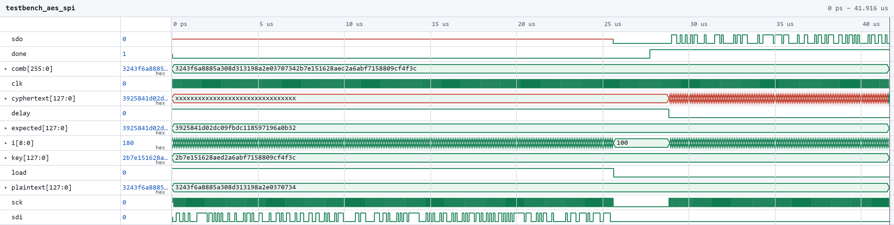
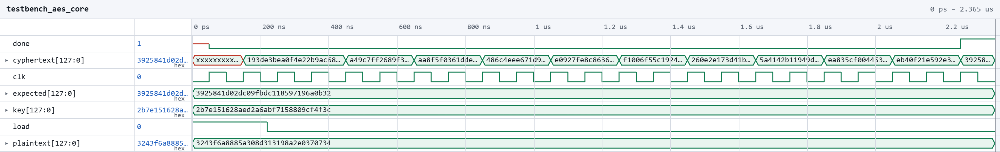

## Introduction

The goal of this lab is to build a hardware accelerator for 128-bit AES encryption, following the FIPS-197 standard. The STM32L432KC MCU sends a 128-bit plaintext and a 128-bit key to the FPGA over SPI, the FPGA runs the AES cipher, and the MCU reads the 128-bit ciphertext back over SPI and compares it against the expected result.

AES-128 (Nk = 4, Nb = 4, Nr = 10) encrypts a 16-byte state in 10 rounds. Each round applies four steps:

- **SubBytes**: replaces every byte with its sbox entry.
- **ShiftRows**: rotates row *r* of the state left by *r* bytes.
- **MixColumns**: mixes the four bytes of each column with Galois field arithmetic. The final round skips this step.
- **AddRoundKey**: XORs the state with the round key.

Before round 1, the plaintext is XORed with the original key, and each round uses a new round key generated by KeyExpansion from the previous one.

## Design and Testing Methodology

The SPI interface (`aes_spi`), the top level (`aes`), the sbox lookup (`sbox_sync`, `sbox.txt`) and MixColumns (`mixcolumns`, `mixcolumn`, `galoismult`) are from the [Lab 7 starter code](https://github.com/HMC-E155/hmc-e155//tree/main/lab/lab07), as is the MCU code in `lab7.c`. I wrote `aes_core` and the modules below:

- `aes_core` (in `aes_starter.sv`) contains the datapath with the state and round key registers, the two muxes, and one instance of each step module and of the controller.
- `aes_controller.sv` contains the control logic. This is implemented via a communicating FSM between a canonical FSM that sequences the rounds, and a non-canonical round counter up to 10 rounds.
- `sub_bytes.sv` contains the SubBytes algorithm.
- `shift_rows.sv` contains the ShiftRows algorithm.
- `add_round_key.sv` contains the AddRoundKey algorithm.
- `key_expansion.sv` contains one step of KeyExpansion. It generates the next round key from the previous one using RotWord, SubWord (four `sbox_sync` instances), Rcon and an XOR chain.

### Datapath

The logic is too large to implement all 10 rounds as combinational logic, so `aes_core` reuses one round of hardware in a loop:

1. **AddRoundKey** XORs the output of the data mux with the output of the key mux.
2. The result is written into the 128-bit **state register**.
3. **SubBytes** looks up every byte of the state in the sbox. The sbox is stored in synchronous block RAM, so its output is valid one clock cycle after its input.
4. **ShiftRows** and **MixColumns** follow as combinational logic.
5. The **data mux** (`data_sel`) selects the plaintext for the initial round, the MixColumns output for rounds 1 to 9, and the ShiftRows output for round 10, and feeds it back into AddRoundKey.

The **key mux** (`key_sel`) selects the original key for the initial round and the output of `key_expansion` afterwards. Its output goes both into AddRoundKey and into the 128-bit **round key register**, which feeds `key_expansion` for the next round.

Because of the one-cycle sbox latency, each round takes two clock cycles: one to read the sbox RAM and one to compute the rest of the round and write the registers. An encryption takes 21 cycles in total, 1 for the initial round and 2 for each of the 10 rounds. The ciphertext is the state register after round 10.

### Control logic

The control logic is in `aes_controller`, separate from the datapath. It drives `en` (the write enable for both registers), `key_sel`, `data_sel`, `rcon` and `done` into `aes_core`. It is split into two communicating FSMs:

- **Main FSM** (canonical): four states, LOAD, SUB, EXECUTE and DONE. LOAD writes `plaintext ^ key` into the state register while the MCU is shifting data in, SUB waits for the sbox RAM, EXECUTE writes the round result, and DONE holds the ciphertext and asserts `done`. Raising `load` returns the FSM to LOAD from any state.
- **Round counter** (non-canonical): a 4-bit counter that resets to 1 in LOAD and increments in EXECUTE. It produces `rcon` and `last = (round == 10)`, which tells the main FSM to skip MixColumns and move to DONE after the round.

#### State Transition Diagrams

{width=80% fig-align="center"}

The main FSM stays in LOAD while `load` is high. Once `load` goes low, it alternates between SUB and EXECUTE once per round, and moves to DONE after the EXECUTE where `last` is high. A high `load` returns it to LOAD from any state.

{width=90% fig-align="center"}

The round counter resets to 1 while the main FSM is in LOAD and increments in each EXECUTE. It reaches 11 after the last round, which is harmless since `en` is low in DONE.

### Testing

I ran the top level and spi testbenches provided in the starter code, and both pass.

## Technical Documentation

The source code for the project can be found in the associated [GitHub repository](https://github.com/AngelaZzzzz/hmc-e155-MicroPs/tree/main/labs/lab7/).

### Block Diagram

<!-- TODO: top level block diagram -->


<details>
<summary>Block diagram: aes_top</summary>

<!-- TODO -->


</details>

<details>
<summary>Block diagram: aes_spi</summary>

<!-- TODO -->


</details>

<details>
<summary>Block diagram: aes_core</summary>

<!-- TODO -->


</details>

<details>
<summary>Block diagram: aes_controller</summary>

<!-- TODO -->


</details>

<details>
<summary>Block diagram: sub_bytes and sbox_sync</summary>

<!-- TODO -->


</details>

<details>
<summary>Block diagram: shift_rows</summary>

<!-- TODO -->


</details>

<details>
<summary>Block diagram: mixcolumns, mixcolumn and galoismult</summary>

<!-- TODO -->


</details>

<details>
<summary>Block diagram: add_round_key</summary>

<!-- TODO -->


</details>

<details>
<summary>Block diagram: key_expansion</summary>

<!-- TODO -->


</details>

## Results and Discussion

### Testbench Simulation

<!-- TODO: screenshot -->


Figure 4 shows the full system. While `load` is high, the plaintext and key are shifted in on `sdi`. After `load` goes low, the state register steps through the "Start of Round" values of FIPS-197 Appendix B every two cycles, and `done` rises with the ciphertext `3925841d02dc09fbdc118597196a0b32`, which is then shifted out on `sdo`. The testbench ran successfully with no errors.

<details>
<summary>AES core testbench</summary>

<!-- TODO: screenshot -->


`aes_core` produces `3925841d02dc09fbdc118597196a0b32` and asserts `done` 21 cycles after `load` goes low. The testbench ran successfully with no errors.

</details>

### Hardware

The SPI interconnect between the MCU and FPGA uses the pins listed above, and the clock polarity and phase (`CPOL = 0, CPHA = 0`) match the provided MCU code.

The design meets all of the proficiency requirements. The excellence requirements, running the full SPI transaction on hardware and capturing it on the logic analyzer, were not attempted.

## Conclusion

The FPGA design encrypts a 128-bit plaintext with a 128-bit key following FIPS-197, using one round of hardware in a loop controlled by a communicating FSM, and receives its inputs and returns its ciphertext over SPI. Both the AES core testbench and the full system SPI testbench pass against the FIPS-197 test vectors.

I spent a total of 18 hours working on this lab.

## AI Prototype Summary

Model used: **Claude Haiku 5.5**

### AI Chat Transcript

<details>
<summary>User Prompt</summary>

(With the FIPS-197 AES Specification specification uploaded) Write SystemVerilog HDL to implement the KeyExpansion logic described in the FIPS-197 uploaded document. The module should be purely combinational, using the previous key and current round number to calculate the next key. Assume other required modules (SubWord and RotWord) are already implemented.

</details>

<details>
<summary>AI Response</summary>

```
module key_expansion_aes128 (
    input  logic [127:0] prev_key,   // previous round key: w[4*(r-1)] .. w[4*(r-1)+3]
    input  logic [3:0]   round,      // current round number r (1..10)
    output logic [127:0] next_key    // round key r: w[4*r] .. w[4*r+3]
);

    // Round constant Rcon[j] (FIPS 197 Table 5), leftmost byte only
    function automatic logic [7:0] rcon_byte (input logic [3:0] j);
        case (j)
            4'd1:    rcon_byte = 8'h01;
            4'd2:    rcon_byte = 8'h02;
            4'd3:    rcon_byte = 8'h04;
            4'd4:    rcon_byte = 8'h08;
            4'd5:    rcon_byte = 8'h10;
            4'd6:    rcon_byte = 8'h20;
            4'd7:    rcon_byte = 8'h40;
            4'd8:    rcon_byte = 8'h80;
            4'd9:    rcon_byte = 8'h1b;
            4'd10:   rcon_byte = 8'h36;
            default: rcon_byte = 8'h00;
        endcase
    endfunction

    logic [31:0] w0, w1, w2, w3;
    logic [31:0] rot_w3, sub_w3, temp;
    logic [31:0] n0, n1, n2, n3;

    // Split previous key into words
    assign w0 = prev_key[127:96];
    assign w1 = prev_key[95:64];
    assign w2 = prev_key[63:32];
    assign w3 = prev_key[31:0];

    // temp = SubWord(RotWord(w[i-1])) ^ Rcon[i/Nk]
    RotWord u_rotword (
        .in  (w3),
        .out (rot_w3)
    );

    SubWord u_subword (
        .in  (rot_w3),
        .out (sub_w3)
    );

    assign temp = sub_w3 ^ {rcon_byte(round), 24'h000000};

    // w[i] = w[i-Nk] ^ temp, then chained for the remaining words
    assign n0 = w0 ^ temp;
    assign n1 = w1 ^ n0;
    assign n2 = w2 ^ n1;
    assign n3 = w3 ^ n2;

    // Pack the new round key
    assign next_key = {n0, n1, n2, n3};

endmodule
```

</details>

<details>
<summary>User Prompt</summary>

Write SystemVerilog HDL to implement the following logic:

i = 0
while i < Nk do
    w[i] <- key[4*i..4*i+3]
    i <- i+1
end while
while i <= 4 * Nr + 3 do
    temp <- w[i-1]
    if i mod Nk = 0 then
        temp <- module1(module2(temp)) (+) Rcon[i/Nk]
    else if Nk > 6 and i mod Nk = 4 then
        temp <- module1(temp)
    end if
    w[i] <- w[i-Nk] (+) temp
    i <- i + 1
end while
return w
Assume module1 and module2 are existing modules that can be instantiated. (+) refers to XOR. Unwrap the loop in the provided pseudo code so it uses the previous iterations output to generate the new iteration.

Do not use any existing knowledge of the AES specifications in your answer.

</details>

<details>
<summary>AI Response</summary>

```
// Fully unrolled key expansion.
// Each generate iteration is one pass of the pseudo-code's second while loop.
// Word i reads w[i-1] and w[i-Nk] from earlier stages, so the chain is
// unrolled and purely combinational.
module key_expansion_unrolled #(
    parameter int Nk = 4,                          // key length in 32-bit words
    parameter int Nr = 10,                         // number of rounds
    parameter int NW = 4*Nr + 4,                   // total words produced: w[0..4Nr+3]
    parameter int RCON_LEN = (4*Nr + 3)/Nk + 1     // Rcon indices used: i/Nk, index 0 unused
) (
    // Key packed as bytes-in-words: key word i is key[32*i +: 32]
    input  logic [32*Nk-1:0]      key,
    // Rcon table packed: Rcon[j] is rcon[32*j +: 32]
    input  logic [32*RCON_LEN-1:0] rcon,
    // Expanded key: w[i] is w_out[32*i +: 32]
    output logic [32*NW-1:0]      w_out
);

    // Internal word array
    wire [31:0] w [0:NW-1];

    // ------------------------------------------------------------------
    // Step 1: w[i] <- key[4*i..4*i+3] for i < Nk
    // ------------------------------------------------------------------
    for (genvar k = 0; k < Nk; k++) begin : g_init
        assign w[k] = key[32*k +: 32];
    end

    // ------------------------------------------------------------------
    // Step 2: unrolled expansion loop for i = Nk .. 4*Nr+3
    // ------------------------------------------------------------------
    for (genvar i = Nk; i < NW; i++) begin : g_expand
        logic [31:0] temp;

        if (i % Nk == 0) begin : g_rot_sub
            // temp <- module1(module2(temp)) XOR Rcon[i/Nk]
            logic [31:0] m2_out, m1_out;

            module2 u_m2 (
                .in  (w[i-1]),
                .out (m2_out)
            );

            module1 u_m1 (
                .in  (m2_out),
                .out (m1_out)
            );

            assign temp = m1_out ^ rcon[32*(i/Nk) +: 32];

        end else if (Nk > 6 && (i % Nk == 4)) begin : g_sub_only
            // temp <- module1(temp)
            logic [31:0] m1_out;

            module1 u_m1 (
                .in  (w[i-1]),
                .out (m1_out)
            );

            assign temp = m1_out;

        end else begin : g_pass
            // temp keeps w[i-1]
            assign temp = w[i-1];
        end

        // w[i] <- w[i-Nk] XOR temp
        assign w[i] = w[i-Nk] ^ temp;
    end

    // ------------------------------------------------------------------
    // Step 3: return w
    // ------------------------------------------------------------------
    for (genvar k = 0; k < NW; k++) begin : g_out
        assign w_out[32*k +: 32] = w[k];
    end

endmodule
```

</details>

### Summary

The first implementation with context is a lot simpler than the second implementation, where AI translated a code piece into system verilog.
