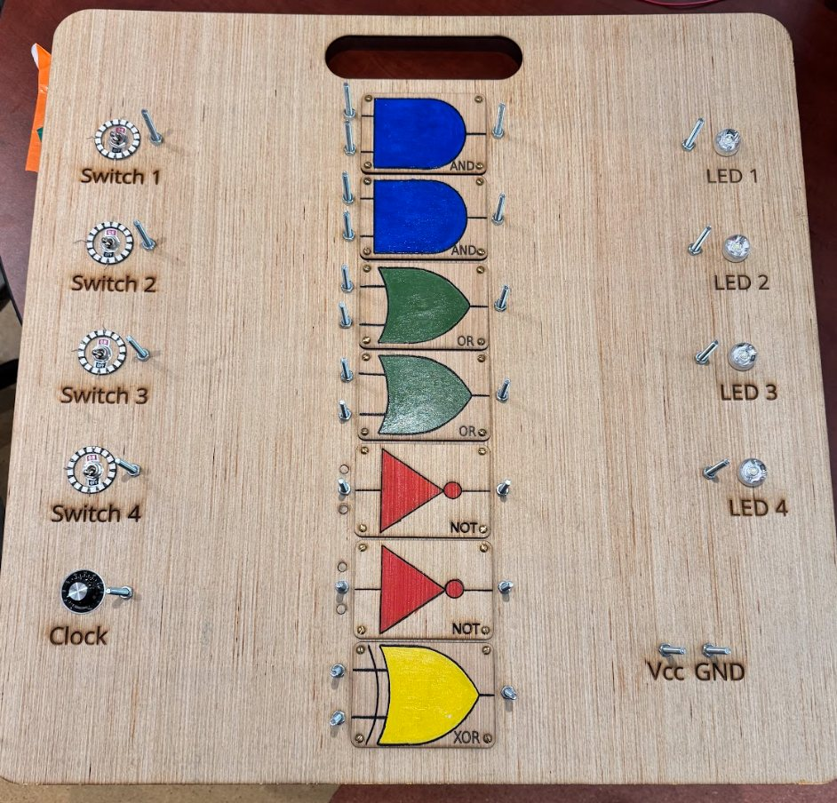
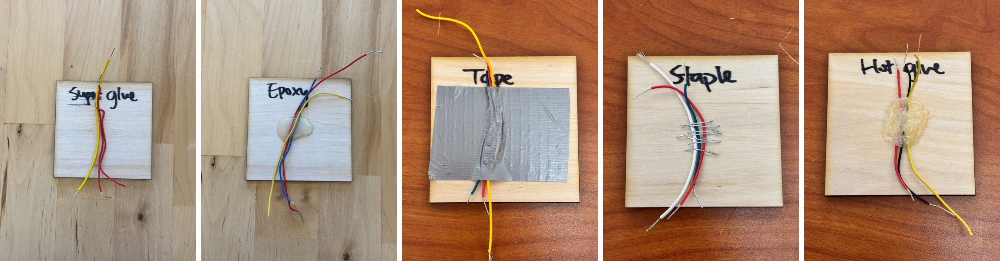
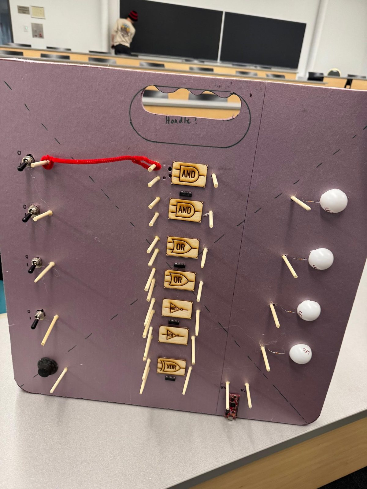
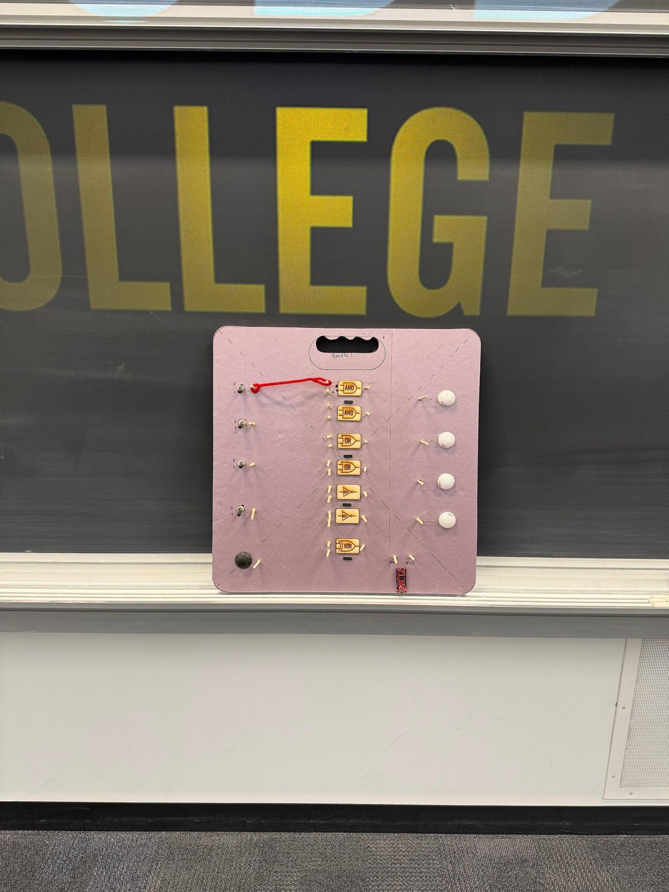
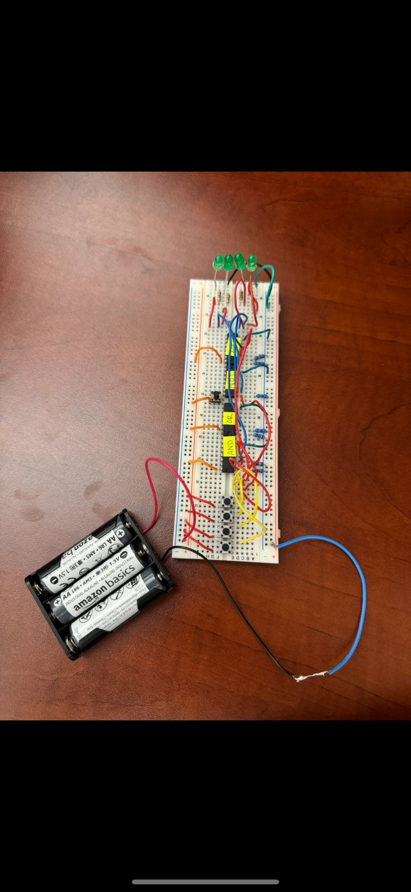
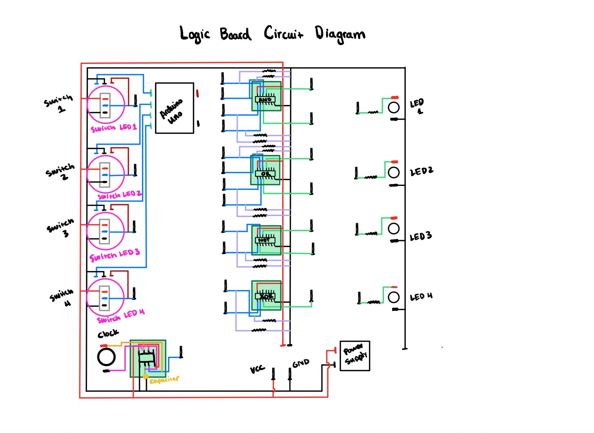
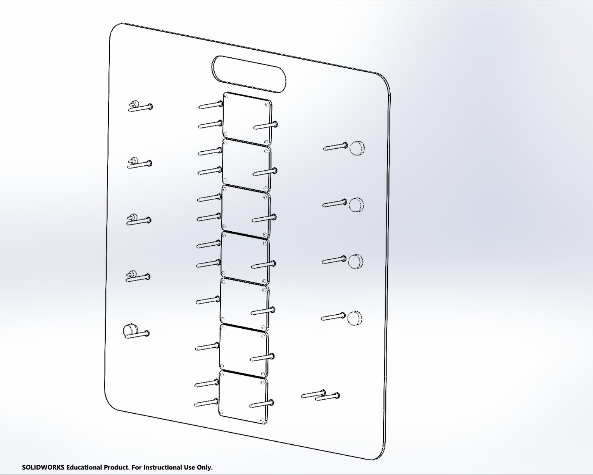
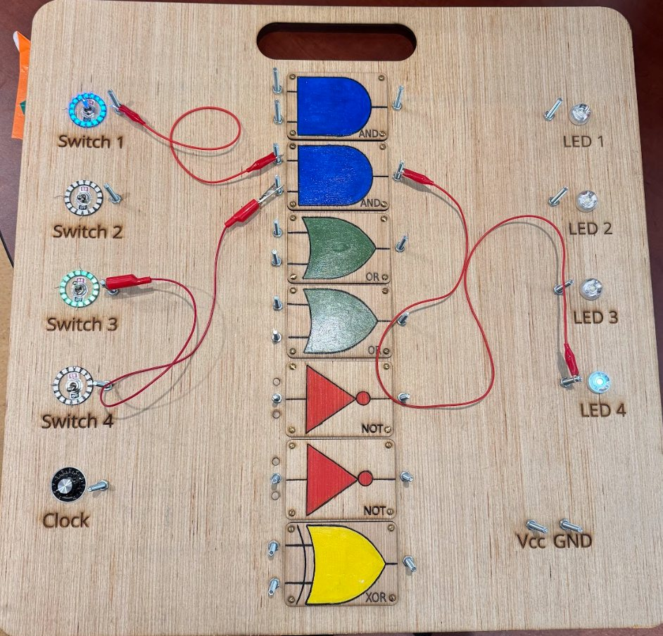
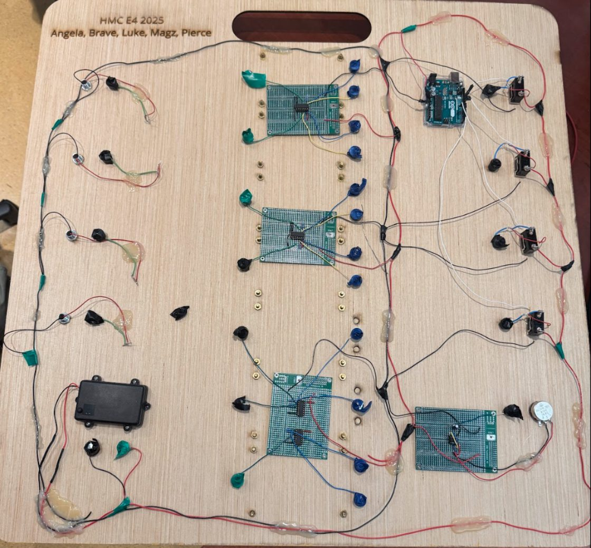

::: {.project-meta}
**Course** · E4 Introduction to Engineering Design, Harvey Mudd College

**Timeline** · Spring 2025

**Team** · Team Logic: Angela Zheng, Brave Yonghiphatwong, Luke Murphy, Magz Brooke-Hodge, Pierce Clark

**Client** · Prof. David Harris, for E85 Digital Electronics & Computer Engineering

**Tools** · SolidWorks, laser cutter, logic ICs, breadboarding
:::

{fig-alt="Laser-engraved plywood board with colored logic gate symbols, toggle switches on the left and LEDs on the right" width=80% fig-align="center"}

## The problem

Prof. Harris teaches logic gates to roughly 70 students in E85 with a demo board, and the old
one was falling apart, with cables coming loose. He needed a replacement that every student
could read from the **back row of Shanahan B460**, that held up to being carried to class, and
that stayed simple to wire live during lecture.

We turned client interviews into four objectives (**durability, visibility, portability, and
ease of use**) and a set of hard constraints:

| Constraint | Target | Final board | |
|---|---|---|:-:|
| Logic gates | ≥ 2 AND, 2 OR, 2 NOT, 1 XOR | 2 AND, 2 OR, 2 NOT, 1 XOR | ✅ |
| Inputs / outputs | ≥ 4 switches, ≥ 4 observable outputs | 4 switches, 4 LEDs | ✅ |
| Clock | adjustable speed | rotary-knob clock | ✅ |
| Cost | < $200 | **$153.71** | ✅ |
| Size | side length ≤ 0.8 m | 30 × 30 in (0.76 m) | ✅ |
| Weight | < 5 lb | 6.47 lb | ❌ |

: Requirements vs. the final prototype {.striped}

## Prototyping

We built a separate prototype to answer each of our biggest open questions.

### 1 · How should we attach wires so they survive being carried around?

We attached wires to plywood coupons five ways: super glue, epoxy, duct tape, staples, and hot
glue. Then we put each through abrasion against wood and iron, five drops each from 2, 3, and
4 ft, and repeated tugging. The super-glued and epoxied wires came off. Tape and staples
survived but could conduct or snag, so **hot glue** won.

{fig-alt="Five wooden squares, each with wires attached using a different method"}

### 2 · Can students actually see it from the back row?

We built a full-size foam mock-up with real switches, LEDs, and laser-cut labels and set it at
the front of B460. Each team member scored visibility from 0 to 5 at every row. The switches
and LEDs were fine, but the gate labels and the 0/1, Vcc and GND markings were unreadable
past the first couple of rows, so the labels needed to be much bigger and the gates easier to tell apart.

::: {.gallery .gallery-tall}
{fig-alt="Foam board mock-up with switches and paper gate labels"}

{fig-alt="The mock-up propped in front of a lecture hall blackboard"}

{fig-alt="A breadboard with logic ICs, switches and LEDs"}
:::

### 3 · Does the circuit work?

We drew the full circuit, including the clock, and breadboarded the switches, gates and LEDs
before committing to the final layout.

{fig-alt="Hand-drawn circuit diagram of switches, logic ICs, LEDs and power" width=80% fig-align="center"}

## Final design

- **Board:** laser-cut, laser-engraved plywood, modeled in SolidWorks so every hole and label
  lined up with its component.
- **Visibility:** each gate type is a large, painted, color-coded shape (blue AND, green OR,
  red NOT, yellow XOR). Light-up rings make each switch's state obvious, and the LEDs are bright.
- **Connections:** conductive bolts at every gate pin, so Prof. Harris can wire circuits live
  with the alligator clips he's used to. Components are bolted and hot-glued on the back.
- **Power and clock:** a battery pack replaced our original USB-C plan, which our advisor flagged
  as not durable enough, plus a rotary knob that sets the clock rate.

::: {.gallery}
{fig-alt="CAD model of the board with hole patterns"}

{fig-alt="The board with red alligator clips connecting switches to gates and lit LEDs"}

{fig-alt="The back of the board showing logic IC breakout boards and wiring"}
:::

## Evaluation

We repeated the B460 visibility test with the finished, powered board and eight observers,
standing directly in front of the board and at random seats on each side.

```{=html}
<figure class="vis-chart" aria-label="Average visibility score by row, first prototype versus final board">
  <div class="vis-legend">
    <span><i class="vis-swatch vis-old"></i>Foam mock-up</span>
    <span><i class="vis-swatch vis-new"></i>Final board</span>
  </div>
  <div class="vis-rows"></div>
  <figcaption>Average visibility score (0 = can see nothing, 5 = every component and label clear) by row in Shanahan B460.</figcaption>
</figure>
<script>
(function () {
  const rows = [["Row 1", 4.3, 4.87], ["Row 2", 3.1, 4.75], ["Row 3", 2.5, 4.18],
                ["Row 4", 1.4, 3.75], ["Row 5", 0.6, 3.18], ["Back row", 0, 3.06]];
  const host = document.currentScript.previousElementSibling.querySelector(".vis-rows");
  host.innerHTML = rows.map(([r, a, b]) => `
    <div class="vis-row">
      <span class="vis-name">${r}</span>
      <div class="vis-bars">
        <div class="vis-bar vis-old" style="width:${a / 5 * 100}%" title="${r} · foam mock-up: ${a}"></div><span class="vis-val">${a.toFixed(1)}</span>
        <div class="vis-bar vis-new" style="width:${b / 5 * 100}%" title="${r} · final board: ${b}"></div><span class="vis-val">${b.toFixed(2)}</span>
      </div>
    </div>`).join("");
})();
</script>
```

The final board scored **above 3 in every row**, up from 0 in the back row for the mock-up.
Every component stayed visible and the gates could be told apart by shape and color
throughout the room. The engraved text labels still faded by rows 4–6, especially when the
LEDs and switch rings were lit.

## What I'd change

- **Weight:** the board came in 1.47 lb over its 5 lb target, mostly from the bolts.
  Lighter hardware and thinner label stock would close the gap.
- **Stiffness:** the plywood flexes slightly, so a thicker panel or a composite would hold up
  better over years of use.
- **Labels:** the engraved text needs to be larger and higher contrast to read from the back row.

The board kept everything Prof. Harris liked about the old one, alligator-clip wiring included,
while making it far more visible and durable for future E85 students.
