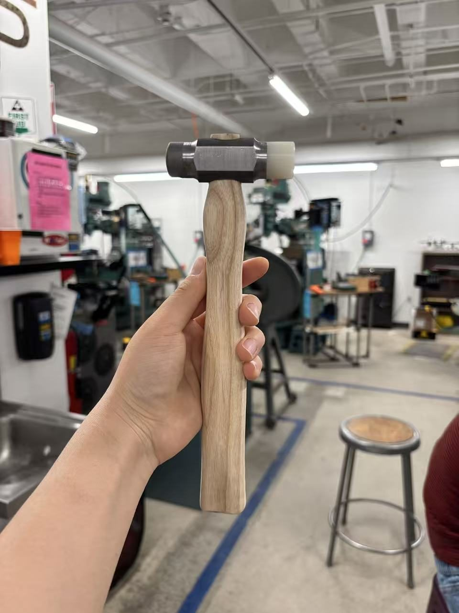
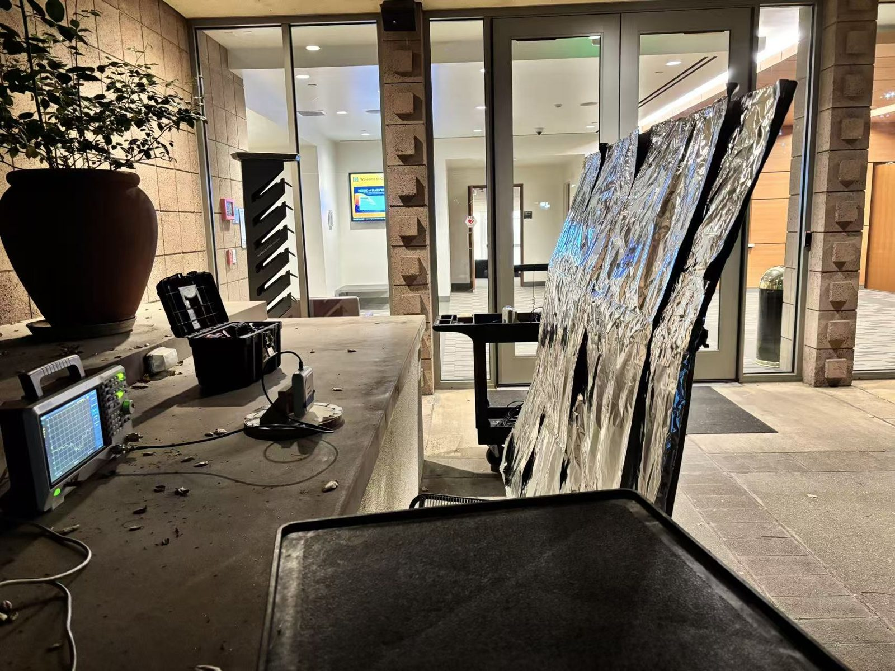

<!-- TODO: add a sentence or two of context to each item -->

Not everything fits in a project write-up. Here are some of the other things I've built and
tested along the way.

## Hammer

[May 2025]{.item-date}

A hammer I made in the machine shop.

{fig-alt="Holding a hammer with a wooden handle in a machine shop" width=55% fig-align="center"}

## Testing RF reflection in the middle of the night

[March 2025]{.item-date}

Sometimes the lab is only quiet enough for RF measurements after midnight.

{fig-alt="RF test equipment set up at night" width=90% fig-align="center"}
