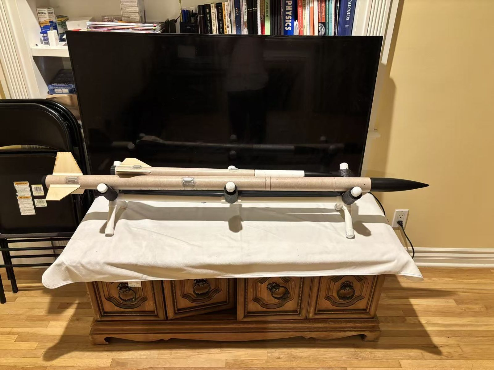
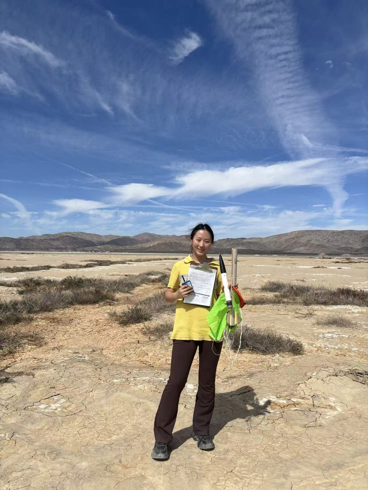
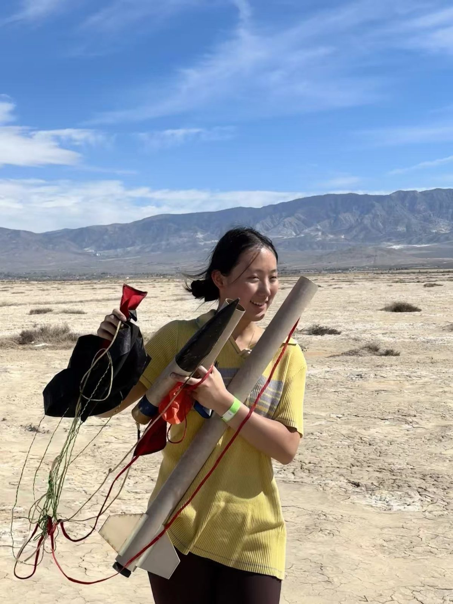
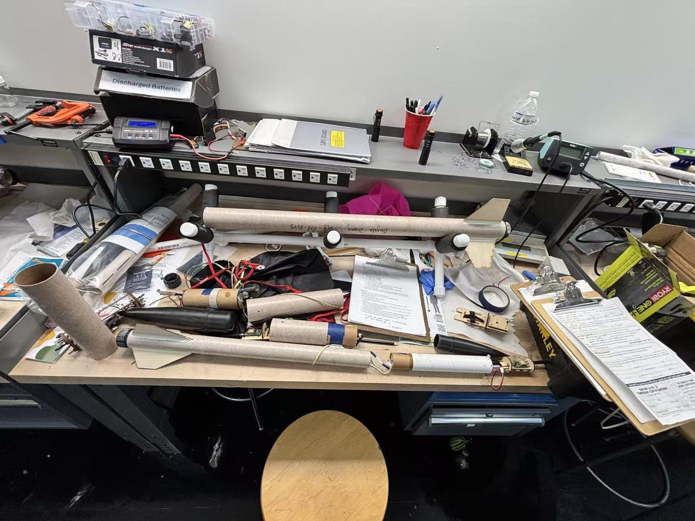
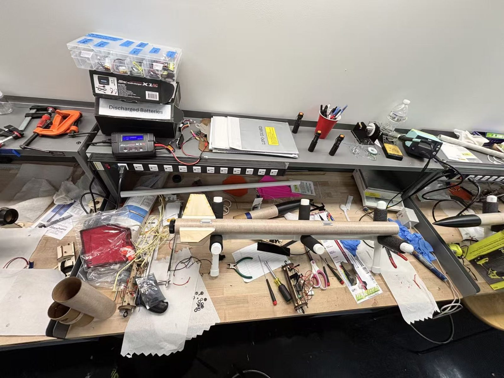

<!-- TODO: add launch details (motors, altitudes, launch site/date, certifying organization) -->

::: {.project-meta}
**Certifications** · High-power rocketry Level 1 and Level 2

**Rockets** · Mini DX3 (L1), Vulcanite dual deploy (L2)

**Skills** · Airframe construction, fin alignment, epoxy work, dual-deployment recovery
:::

{fig-alt="A finished rocket resting on a stand" width=90% fig-align="center"}

## Level 1: Mini DX3

My first high-power rocket was a **Mini DX3**, which I built and flew for my **Level 1
certification**. L1 means flying an H- or I-impulse motor with a stable flight and a successful
recovery, with the rocket coming back in flyable condition.

## Level 2: Vulcanite dual deploy

For **Level 2**, I built a **Vulcanite** with a **dual-deployment** recovery system. An onboard
altimeter fires a small drogue chute at apogee so the rocket descends quickly without drifting
far. The main parachute then opens at a lower altitude for a soft landing. Getting the
electronics bay, ejection charges, and parachute packing right is most of the challenge. Level 2
also requires passing a written exam on rocketry safety and theory.

::: {.gallery .gallery-tall}
{fig-alt="Angela holding a certificate and the Mini DX3 in the desert"}

{fig-alt="Angela holding the recovered Vulcanite airframe and parachute"}
:::

## The build

Both rockets were built at my workbench: sanding and gluing airframe tubes, aligning and
filleting fins, and assembling the motor mount and recovery hardware.

::: {.gallery}
{fig-alt="A cluttered workbench with rocket airframe parts and tools"}

{fig-alt="Workbench with two rocket airframes and building supplies"}
:::
