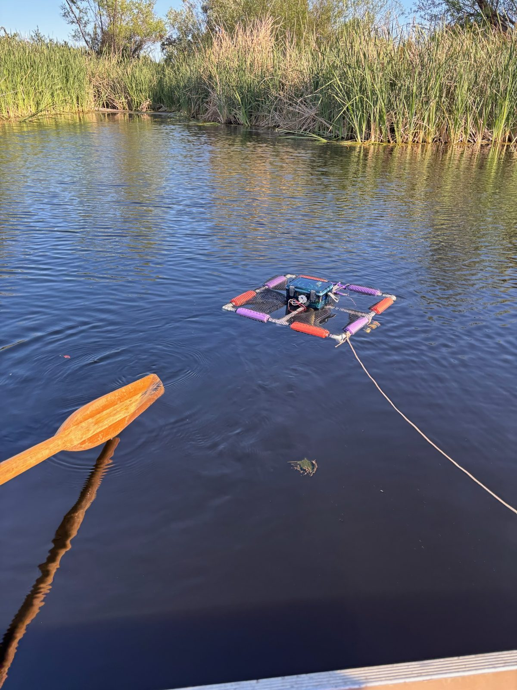
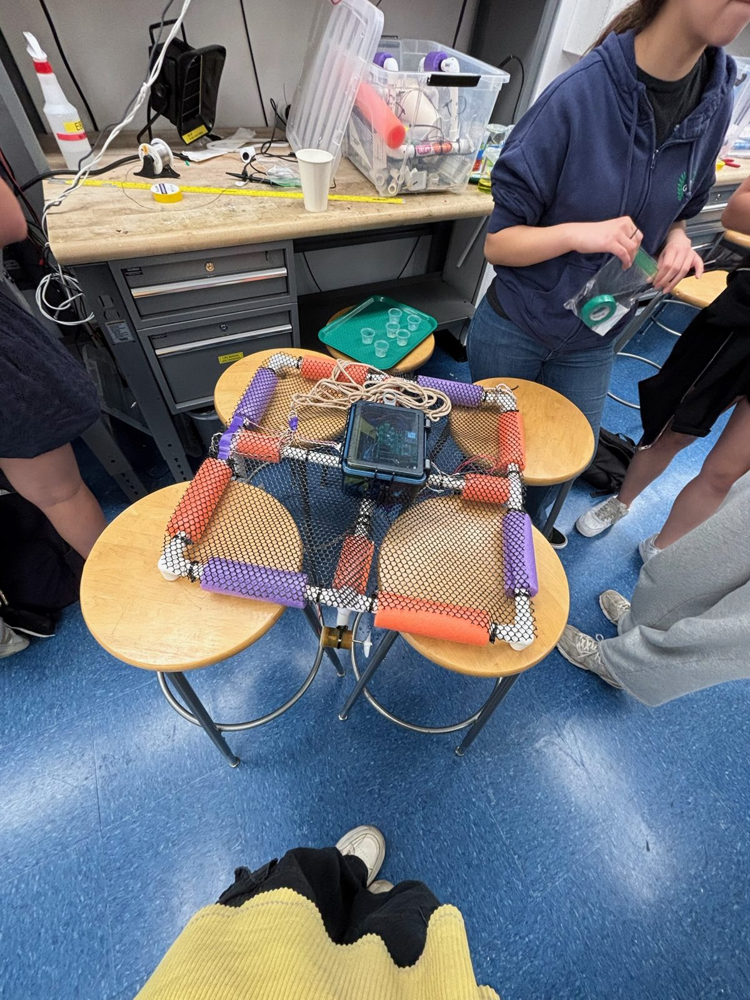
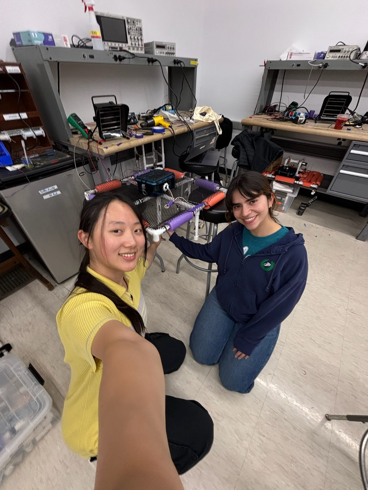

::: {.project-meta}
**Course** · E80 Experimental Engineering, Harvey Mudd College

**Timeline** · Spring 2026

**Team** · Team 36: Angela Zheng, Heidi Repp, Maraki Solomon, Soraya Zarazua

**Tools** · Teensy, op-amp signal conditioning, 555 timer, MATLAB
:::

## Overview

Do ocean temperature, pH, and turbidity change with distance from shore, where human activity
is concentrated? To find out, our team built a floating autonomous surface robot carrying a thermistor, a pH probe,
and a custom IR turbidity sensor, each with its own analog signal-conditioning circuit. We deployed it at **Dana Point, California**. It traveled
from 5 m to about 35 m offshore, stopping every 5 m to sample at 10 Hz.

::: {.gallery .gallery-tall}
{fig-alt="The surface robot floating on a lake, tethered to a kayak"}

{fig-alt="The robot frame with pool-noodle floats and the electronics box"}

{fig-alt="Angela and a teammate with the robot in the lab"}
:::

## Sensor design

Each sensor's output is scaled and offset into the **0.3–3 V** input range of the Teensy ADC.
That uses as much of the ADC range as possible while leaving a 0.3 V margin against clipping.

- **Thermistor (temperature).** A Murata 47 kΩ NTC thermistor in a voltage divider. The expected
  10–20 °C ocean range maps to 1.12–2.21 V, and an inverting offset amplifier (G = −2.47)
  maps that to 0.3–3 V.
- **pH electrode.** A unity-gain buffer biases the reference electrode at 1 V. Using the
  Nernst relation from TI's AN-1852, the expected pH range gives 0.86–1.03 V, which an
  offset amplifier with a gain of 15.9 maps into the ADC range.
- **IR turbidity sensor.** A 555-timer oscillator (720 Hz, 60% duty cycle) pulses an IR LED at
  38 mA. Two photodiodes, one opposite the LED (180°) and one at 90°, feed transimpedance
  amplifiers, then min/max peak detectors that turn the pulsed signal into a DC voltage.

## Mechanical design & waterproofing

- The robot weighed **1.79 kg**. The center of mass (14.09 cm) and center of buoyancy
  (14.94 cm) were computed from per-component masses and volumes. Buoyancy sits above mass on the same axis,
  so the robot is passively stable.
- The flat, low-profile frame reduces wind loading. Symmetric floats resist roll and yaw, and
  we added four more floats after the lake test.
- The probes pass through the bottom of the electronics box and are sealed with marine epoxy.
  The turbidity optics sit in a custom PVC housing 14 cm below the frame to block surface light.

## Results

::: {.stat-grid}
::: {.stat}
[18.62 °C]{.stat-num}
[measured vs. 18.7 °C ground truth]{.stat-label}
:::
::: {.stat}
[R² = 0.999]{.stat-num}
[thermistor calibration fit]{.stat-label}
:::
::: {.stat}
[p < 10⁻⁵]{.stat-num}
[all three indicators differ, 5 m vs 35 m]{.stat-label}
:::
:::

Two-sample t-tests compared the first and last stationary measurement windows (5 m and 35 m
offshore). Temperature, pH, and turbidity each differed significantly, with p = 8.7 × 10⁻¹²,
1.1 × 10⁻⁴¹, and 1.5 × 10⁻⁶. The temperature reading closely matched ground truth. The pH
reading (7.3–7.5 vs. 8.0) and turbidity reading were less accurate, most likely because the
calibration conditions didn't match the ocean and the 180° photodiode had a waterproofing
failure. Distance from shore is only a proxy for human activity, so the experiment shows
correlation, not causation.

**Lessons learned:** calibration and waterproofing matter as much as the circuit design.
Next time, I would calibrate the turbidity sensor in ocean-like lighting and orientation,
narrow the pH calibration to the 7–8.5 seawater range, and log GPS with every sample.

## Final report

[Download the report (PDF)](angela-zheng-e80-final-report.pdf){.btn .btn-outline-primary .btn-sm}

```{=html}
<object class="pdf-embed" data="angela-zheng-e80-final-report.pdf#view=FitH" type="application/pdf" aria-label="E80 final report">
  <p>Your browser can't display PDFs inline. <a href="angela-zheng-e80-final-report.pdf">Download the report</a> instead.</p>
</object>
```
